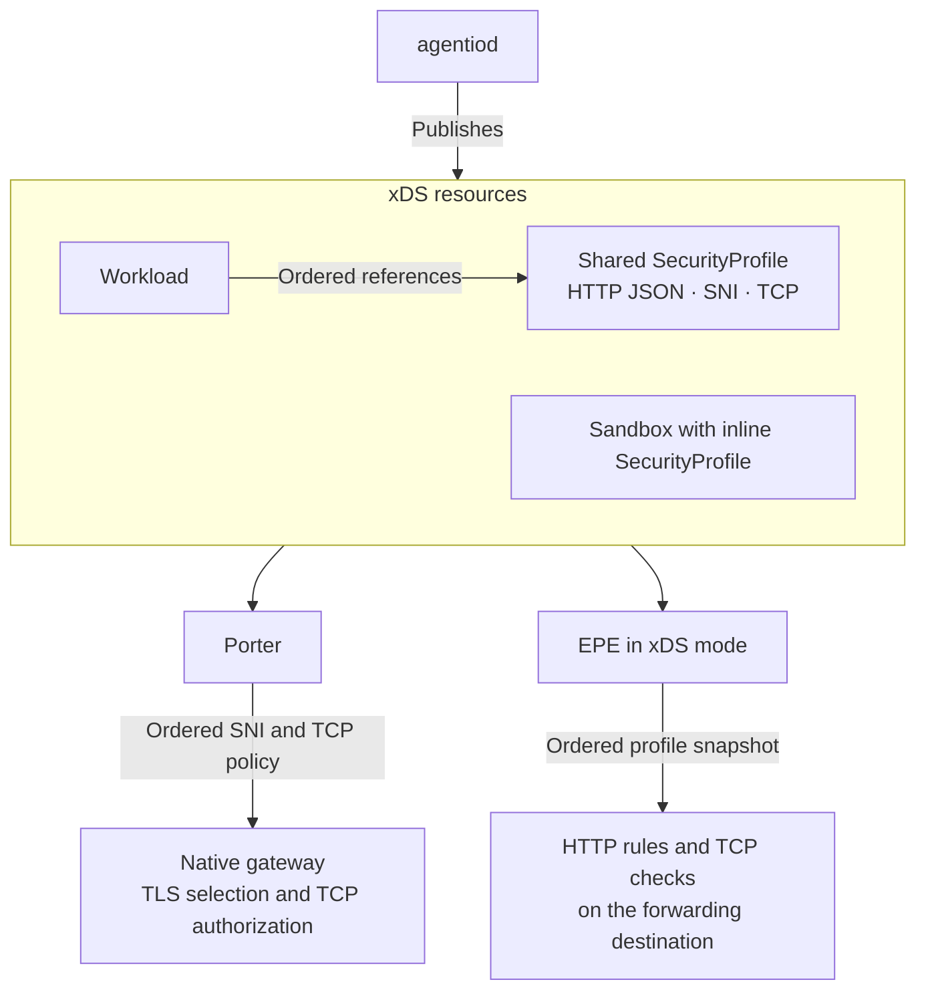

# SecurityProfile gateway destination rules

TrafficPolicy keeps its sandbox/ztunnel execution point. SecurityProfile owns
HTTP/TLS processing and TCP destination fallthrough at the native egress gateway.
No separate TLS rule list is introduced: existing `rules[].actions.tls` remains.

```yaml
spec:
  rules:
  - name: allow-api
    match:
    - domains: [api.example.com]
      schemes: [https]
      ports: [443]
    actions:
      bypass: true
  tcpRules:
  - name: deny-other-destinations
    match:
    - cidrs: ["0.0.0.0/0", "::/0"]
    action: Deny
```

Applicable profiles keep existing priority order; Sandbox inline rules follow
shared profiles. TCP rules use first match, OR between clauses/CIDRs/ports, and
AND between CIDR and port within a clause. An unmatched profile continues to the
next profile; only the end of the complete chain defaults to allow.

HTTP evaluates each complete profile before moving to the next one:

```text
SP A: HTTP rules → TCP rules → SP B: HTTP rules → TCP rules → Sandbox SP → allow
       bypass/block ── stop          bypass/block ── stop
                   allow/deny ── stop           allow/deny ── stop
```

Only nonterminal HTTP actions and unmatched TCP rules continue. For example, SP A's TCP deny cannot be overridden by SP B's HTTP bypass; SP A's TCP allow also skips SP B's HTTP block. Each TCP checkpoint resolves the effective HTTP target, applies independent platform restrictions, and evaluates the TCP rules through the current profile once. Final authorization resolves the final target, applies platform restrictions, rechecks the visited TCP prefix, and pins the selected address. Candidate resolution does not invoke the request-bound TCP authorizer. Resolution or authorization errors at either a checkpoint or final authorization produce a local error response, so ext_proc transport fail-open cannot skip a failed authorization.

After TLS termination, HTTP requests evaluate the complete profile chain from the highest priority. EPE does not consume a TLS selection cursor. Explicit SNI passthrough supplies a TCP view ending before the matched profile; post-termination processing uses the full snapshot.

TLS evaluates each profile’s SNI rules followed by its TCP rules against the original destination. A TCP allow or deny ends selection before any lower-priority SNI rule. An explicit SNI passthrough resolves the SNI and rechecks earlier profiles against the selected address; it skips the matching profile’s TCP rules and all lower-priority profiles.

| Path | Destination authorization | Forwarding target |
| --- | --- | --- |
| HTTP block | Reject immediately | None |
| HTTP bypass | Skip current/lower SP TCP rules; retain earlier restrictions and platform checks | Authorized, pinned Host/route target |
| HTTP mutation only / no match | SP TCP rules and platform checks | Authorized, pinned Host/route target |
| Explicit TLS deny | Reject immediately | None |
| Explicit TLS passthrough | Recheck earlier SP TCP rules; skip current/lower profiles | SNI DNS destination, encrypted bytes unchanged |
| TLS no match (`fallthrough`) | Original-destination TCP decision | Original CONNECT IP and port |
| Terminated TLS carrying HTTP | HTTP processing above | HTTP target |
| Terminated TLS carrying another protocol | Full TCP chain against the resolved destination | Pinned outer-SNI address, retaining SNI/SAN for TLS origination |
| Raw TCP / configured TCP passthrough | Original-destination TCP decision | Original CONNECT IP and port |
| Protocol inspection timeout | Reject, following the gateway inspection deadline | No connection |

Native gateway `tlsTermination.excludeHosts` prevents decryption, not authorization. A selected SNI/TCP deny remains denied. When an exclusion changes a selected termination to passthrough, the final destination is checked against the full TCP chain. Explicit policy passthrough retains its earlier-profile scope. The Rust listener produces the policy action and TCP scope boundary. The Envoy matcher applies exclusions only under the termination branch, without changing that boundary; the network filter executes the resulting TCP view. Independent gateway denied CIDRs apply in all cases.

Fixed ServiceEntry endpoint TLS passthrough uses ORIGINAL_DST. Post-termination endpoint TCP uses ORIGINAL_DST with an upstream TLS transport socket, preserving the original port and outer SNI/SAN identity. These paths do not create a DNS resolver or use DFP. Domain-based paths resolve and authorize a numeric address in Rust, then forward through ORIGINAL_DST. HTTP requests retain interleaved HTTP/TCP rule evaluation in EPE; the Rust HTTP entry point only enforces gateway destination restrictions.

A TCP deny is a fallthrough rule, not an unconditional IP restriction: an earlier HTTP bypass skips later SP rules. Explicit TLS passthrough preserves earlier profiles’ TCP restrictions on the resolved destination. For a universal platform deny, keep independent platform enforcement. For “inject credentials for a domain, otherwise deny private addresses”, use a nonterminal mutation rule plus private CIDR denies; do not add bypass to that rule.

The control plane publishes one compiled `agentio.security.SecurityProfile` per
shared profile, containing HTTP JSON and typed `agentio.security.SNIPolicy` and
`agentio.security.TCPPolicy` fields. Workloads carry ordered references;
Sandboxes embed their own SecurityProfile in extensions. HTTP/TCP-only profile updates
change the profile resource without republishing Workloads. During compatibility
rollout, SNI changes also update the legacy embedded Workload/Sandbox SNI projection. Porter resolves all
references under the existing CONNECT deadline and uses the same captured profiles
for TCP decisions and SNI metadata.

Adjacent SNI entries with identical action and port sets merge their domain lists.
Entries separated by a different action remain ordered, including wildcard matches.
TCP rules retain their source order; shared profiles follow the existing priority
ordering and precede the Sandbox profile.
Porter uses an authenticated identity and one captured resource snapshot to return the ordered per-profile SNI/TCP view in `agentio:connection:policy` metadata. The gateway registers this immutable view in a worker-local shared store and passes its content hash through `agentio.connection.policy_hash`. CONNECT and TCP consumers hold references until the last consumer exits; SNI and TCP share one lazy parse per stored view. Raw TCP and unmatched TLS are authorized by the Rust network filter against the original address before TCP proxy connects. Explicit SNI passthrough resolves SNI and rechecks earlier profiles against the selected numeric address; its own TCP rules are skipped. TLS termination relays the full policy hash to the next listener. The passthrough profile boundary is not relayed. Missing or malformed connection policy fails closed; an empty profile list is valid and allows traffic. Porter emits only the grouped connection policy, without a flat SNI projection or an original-address decision. Only successfully compiled profiles are published; a missing referenced profile remains an unavailable dependency.
EPE binds the TCP chain to the same profile snapshot as HTTP rules, checks final
addresses, and uses the existing upstream-address pinning path.

This changes native gateway deployment contracts: install the updated SecurityProfile and GlobalSecurityProfile CRDs, and use matching Agentiod, Porter and connection-policy gateway versions. The control plane retains legacy WDS/Sandbox projections for legacy clients, but Porter no longer provides the old gateway metadata contract. Existing TrafficPolicy restrictions remain independent; SP bypass cannot override a connection already denied by ztunnel.

## API dependency

The API types and CRDs are available in [agents-api #67](https://github.com/openkruise/agents-api/pull/67). Agentio pins `github.com/openkruise/agents-api` to `v0.7.0-alpha1.0.20261113034313-6be2827c6155`; no local module replacement is required. TCP actions use the API's `TCPActionType` values `Allow` and `Deny`. Destination matches accept CIDRs and individual IP addresses.

Sandbox annotations support `security-profile` and `e2b-network`, combined into one inline profile in the order `security-profile.rules → E2B.rules → security-profile.tcpRules → E2B.tcpRules`. The legacy `security-rules` array remains compatible but is mutually exclusive with `security-profile`. See the [Sandbox annotation reference](../reference/security-profile.md#sandbox-policy-annotations) for conversion and update semantics. Sandbox Manager writes the snapshots; its API and migration switch are separate from Agentio's annotation consumption.

## Compiled profile delivery



The two policy messages update together within one SecurityProfile. Multiple shared
profiles are separate xDS resources; this does not promise a transactional update
across profiles. Missing references retain the existing discovery wait/rejection
behavior. Compilation and decode errors keep the existing handling; this change
adds no status protocol or admission webhook. HTTP configuration uses the existing field 4 (`policy_json`); SNI and TCP use
fields 5 and 6. EPE retains Kubernetes and xDS profile-source modes.
