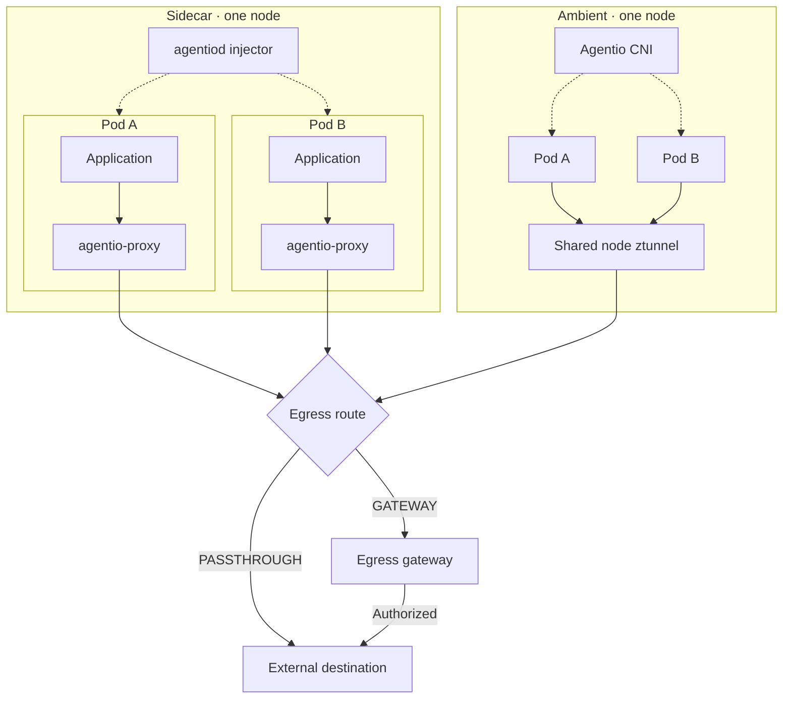

# Getting started

Agentio supports two data-plane profiles. The ambient profile captures traffic with a node-level CNI and ztunnel, while the sidecar profile injects a per-Pod ztunnel. Both profiles use the same `agentiod` control plane and Agentio policy APIs.

## Before you begin

You need a Kubernetes cluster, `kubectl`, Helm 3, and access to the images configured in [`manifests/charts/agentio/values.yaml`](../manifests/charts/agentio/values.yaml). Run the commands in these guides from the repository root.

Install the [Kruise Agents API](https://github.com/openkruise/agents-api) before using `Sandbox` resources. A `Sandbox` is an OpenKruise Sandbox workload — the unit of identity and policy subject in Agentio. Install the [Kubernetes Gateway API CRDs](https://gateway-api.sigs.k8s.io/guides/#installing-gateway-api) before enabling `agentiod.gatewayDeployer.enabled=true`.

## Choose a profile

**Sidecar mode is the recommended deployment mode; ambient mode is Alpha.**

| Profile | Traffic capture | Start here |
| --- | --- | --- |
| Sidecar (recommended) | One injected ztunnel per workload Pod | [Get started with sidecar mode](getting-started/sidecar-mode.md) |
| Ambient (Alpha) | Agentio CNI and one ztunnel per node | [Get started with ambient mode](getting-started/ambient-mode.md) |

The standalone chart defaults to `profile: sidecar`; set `profile: ambient` for ambient mode.

### How the two modes handle outbound traffic

Dotted arrows show capture setup. Solid arrows trace outbound traffic.

In both modes, `agentiod` distributes workload and policy configuration to ztunnel. Ztunnel enforces the workload's L3/L4 policy and uses the configured egress route. The gateway can apply additional destination checks and call the Egress Policy Enforcer (EPE) for HTTP processing. See the [EPE request path](concepts/epe-overview.md).

If OpenKruise Agents creates the workload, start with [Integrate OpenKruise Agents](integrations/openkruise-agents.md) instead. Its embedded installation runs Agentio in the sandbox-manager release and uses sandbox-controller's traffic-proxy injection.

If Istio ambient already captures your workloads, use [Integrate with Istio ambient](integrations/istio-ambient.md) to run an Agentio egress waypoint with the existing Istio CNI, ztunnel, and CA. That guide includes its own deployment, policy, and verification steps; follow it instead of the shared task sequence below.

## Continue with policy and egress

The Agentio sidecar and ambient onboarding guides create a test workload and export the variables used by the task pages. After either of those guides, continue with:

1. [Route traffic through an egress gateway](tasks/route-traffic-through-egress-gateway.md).
2. [Configure a TrafficPolicy](tasks/configure-traffic-policy.md).
3. [Get started with the Egress Policy Enforcer (EPE)](getting-started/epe.md) when Layer 7 request policy is required.

For production settings, upgrades, and profile changes, see the [Agentio Helm chart guide](../manifests/charts/README.md).
